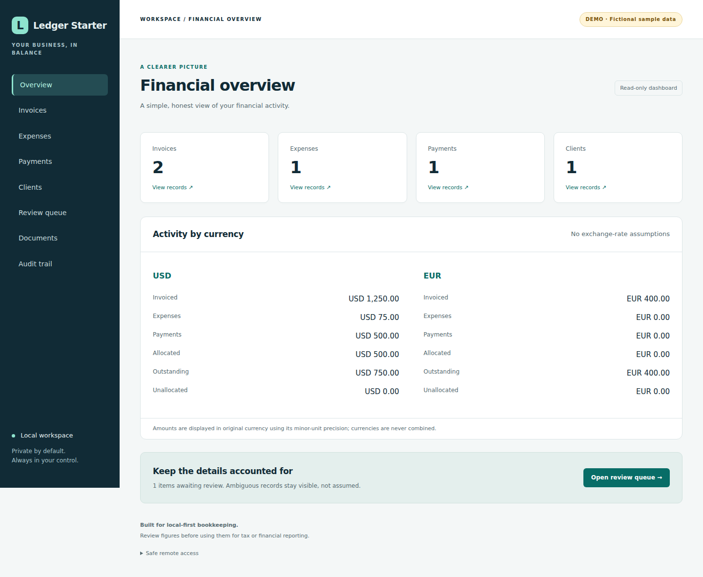

# Ledger Starter for Hermes

**A local-first bookkeeping package you can install through your existing Hermes agent.**

Connect your own Gmail through Composio, let Hermes review financial evidence,
and keep invoices, expenses, incoming payments and source records in your own
SQLite database. A read-only dashboard makes the results easy to inspect.
No Discord account required. No creator's real books or private policies included.

> **Release status:** working starter, not audited accounting software. Local
> installation, MCP and tests can be verified without email credentials. Live
> Composio OAuth must be validated with your own account before unattended use.



## What's included

- Local dashboard: overview by currency, invoices, expenses, incoming payments,
  clients, review queue, document metadata and audit history.
- Typed Hermes MCP tools for ledger writes, payment allocation and review.
- Exact integer minor-unit storage; original currencies kept separate.
- Source IDs and conflict checks for repeat-safe ingestion; ambiguous items go
  to review rather than guessed totals.
- Separate empty live ledger and explicitly fictional demo database.
- Gmail through Composio's hosted MCP server: sign in, no API key. An
  optional API-key connector with enforced read-only scope is also included.
- Generic Hermes bookkeeping skill and hourly/daily scan job templates.
- Installer, copy-paste agent prompt, security guide, VPS instructions,
  locked dependencies and tests.

## Start with one prompt

Paste this into a **working Hermes agent**:

```text
Set up the bookkeeping system from https://github.com/techwithtim/hermes-accounting-starter for me. Clone it into ~/apps/hermes-accounting-starter, then open SETUP.md in that folder and follow it step by step. Stop and ask me whenever it says a step is mine, and never ask me to paste a password or key into this chat.
```

Hermes follows [SETUP.md](SETUP.md): one install command adds the ledger,
the tools and an **Accounting** tab to your Hermes dashboard (same address
and login). Then it walks you through the three things only you can do:
1. Sign in to Composio: click **Authorize** on the `composio` MCP server in
   the Hermes dashboard (or run `hermes mcp login composio` over SSH). No API
   key.
2. Click the Gmail link and approve Google consent (no Google Cloud setup).
3. Approve the first scan before recurring scans are turned on.

**About Gmail access:** Google's consent screen asks for full mailbox access,
because that is what Composio's shared Google app requests. Hermes reads mail
through Composio's MCP server, and the `accounting-starter` skill allows only
four Gmail read tools. That is an instruction to the agent, not a technical
block, so treat email content as untrusted. For a setup where Google itself
enforces read-only access, see [the Composio guide](docs/COMPOSIO.md). Existing Hermes model access,
terminal access and package-download connectivity are prerequisites. Composio
and LLM usage are subject to their respective plans/charges.

## Manual install

Linux, Python 3.11+, [uv](https://docs.astral.sh/uv/getting-started/installation/),
Git, and a configured [Hermes agent](https://hermes-agent.nousresearch.com/docs/).
Clone this repository into its own directory, then from that checkout:

```sh
python3 scripts/install.py --dry-run
python3 scripts/install.py
```

The installer installs locked dependencies, creates an empty live ledger,
registers a new `accounting-starter` MCP server using Hermes's native CLI, and
installs its skill into the active `HERMES_HOME`. It refuses a conflicting MCP
registration/customized skill. Existing unrelated configuration is preserved.
Start a new Hermes session to use the new tools.

Use `--skip-hermes` for a standalone local demo. Use `--data-dir /private/path`
to select private external storage. Do not put financial data in this checkout.
No existing books are imported and no mail is read during installation.

## See the demo

```sh
uv run accounting-starter --demo demo
uv run accounting-starter --demo serve --port 8765
```

Open http://127.0.0.1:8765. For your live ledger, omit `--demo`.
The global `--data-dir` and `--demo` options must precede the command.
Demo and live use separate files; seeding demo never populates live books.

On a Hermes server, use the **Accounting** tab in the Hermes dashboard
instead (same address and login). For the standalone server on a remote
machine, use an SSH tunnel, not a public unauthenticated URL.
See [deployment and service instructions](docs/DEPLOYMENT.md).

## Connect and automate

1. Sign Hermes in to Composio (`hermes mcp login composio`, or Authorize in the
   dashboard) and connect Gmail; see [COMPOSIO.md](docs/COMPOSIO.md).
2. Ask Hermes to load the `accounting-starter` skill and run a review-first scan.
3. Confirm the classification policy and enable the supplied
   [hourly capture/daily review jobs](docs/AUTOMATION.md).
4. Verify a real completed scan before calling automation operational.

Suggested chat requests:
- “Show unpaid invoices and unallocated incoming payments.”
- “Review recent Gmail financial messages; show proposals before booking.”
- “Record this confirmed expense with the original source and currency.”
- “Which items still need evidence or human review?”

## What it is not

This is not a full double-entry/tax ledger, bank reconciliation engine,
invoice-sending system or multi-tenant hosted product. Expenses are evidence
records, not a separate bank cash-out journal. Document links are metadata,
not automatic cloud backup. Attachments can be retrieved, but scanned-PDF OCR
is not bundled. Hermes must read/parse evidence before booking; unreadable
attachments remain review items. Gmail is the first supported provider;
Outlook is not implemented here.

No automated classifier can guarantee correct financial decisions. Source-ID
deduplication does not alone detect different emails about the same economic
event. Review, reconciliation and accountant sign-off still matter.

## Development

```sh
uv sync --frozen --extra dev
uv run --extra dev pytest -q
uv build
```

Dependency versions are locked in `uv.lock`; Composio is additionally pinned
because its auth response contracts are part of our security checks.
Tests use synthetic fixtures, not real mailbox data. Never commit databases,
credentials, runtime outputs or real financial records. Read
[SECURITY.md](docs/SECURITY.md) and [AGENTS.md](AGENTS.md) before modifying.

MIT licensed. Not affiliated with or endorsed by Composio, Google or a hosting
provider. The recipient owns their accounts, credentials and private data.
